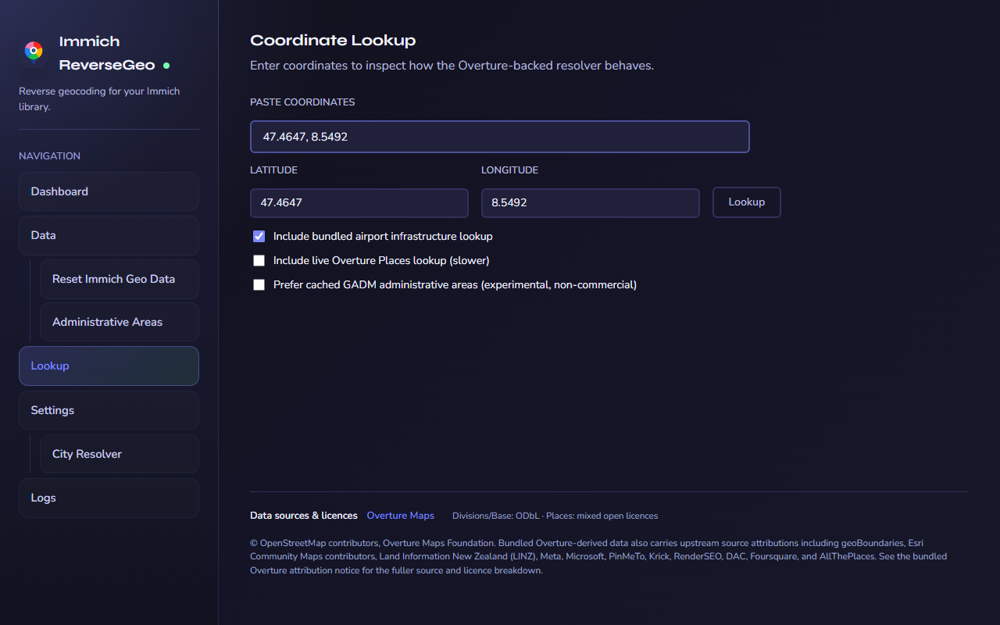

# Using the App

This page covers the day-to-day UI for Immich ReverseGeo after setup is complete.

For install-time settings such as database values, schedules, and processing limits, see [Configuration](./configuration.md).
For a source-by-source explanation of the geographic data behind the app, see [Data Sources](./data-sources.md).

The sidebar keeps the main tools available and includes **Help & setup** for the public guides. Browser tab titles identify the current tool.

## Dashboard

Use `Run Now` on the Dashboard to start a manual processing pass immediately.

- it works even if automatic scheduling is turned off
- it uses your current Settings values for batch size, delay, parallelism, and airport matching
- the Dashboard shows live progress, recent activity, and the last completed run
- `Cancel` stops the current run

Processing selects GPS-tagged assets only when both city and country are missing (stored as `NULL`). To correct existing location names, back up the database and use a targeted reset from [Data tools](#data-tools) before reprocessing.

Run completion and activity timestamps use your browser's local timezone, shown beside each time. This does not change the processing schedule.

## Lookup

Use the Lookup page when you want to test a coordinate before running a full processing pass.

- paste or type coordinates to see how the resolver behaves for that point
- it shows the country match, cached administrative area match, optional airport match, and final values that would be written
- `Include bundled airport infrastructure lookup` lets you test with or without airport matching for that lookup
- `Include nearby places` adds a slower live Overture search for investigation. It shows nearby suggestions and a small sample of excluded places; it does not change the location written to Immich
- `Prefer cached GADM administrative areas` switches the administrative area part of the lookup to an experimental on-demand GADM cache for that country; country detection still starts with the bundled Overture country data

{ .doc-screenshot .on-glb }

Click the screenshot to enlarge it. Lookup previews do not update Immich assets.

## Data tools

The Data area contains maintenance tools that change downloaded caches or Immich reverse geo values.

| Page or action | What it does |
|---|---|
| `Clear Skip List` | Removes permanently skipped assets so they can be retried on the next run. |
| `Reset All Data` | Clears Immich reverse geo `city`, `state`, and `country` values for all matching assets and clears the skip list. |
| `Reset Single Item(s)` | Clears reverse geo values only for the pasted asset GUIDs and removes those assets from the skip list. |
| `Reset Specific Locations` | Finds assets by an existing city, state, or country value and clears all three reverse geo fields for those matching assets. |
| `Delete Overture cache` | Removes one downloaded Overture country cache file. |
| `Re-download Overture cache` | Replaces one downloaded Overture country cache with a fresh copy. |
| `Delete All Overture Divisions` | Removes every downloaded country cache so they will be fetched again on demand later. |
| `Delete GADM cache` | Removes one downloaded GADM country cache file. |
| `Re-download GADM cache` | Replaces one downloaded GADM country cache with a fresh copy. |
| `Delete All GADM Caches` | Removes every downloaded GADM cache so they will be fetched again on demand later. |

The Reset Immich Geo Data page only clears reverse geo values in `asset_exif`. It does not touch any other Immich metadata.

## Logs

Use the Logs page when you want to inspect recent activity outside the Dashboard summary.

- filter the in-app log view to all messages, warnings, or errors
- download the current filtered view as `immich-reversegeo.log`

On-screen timestamps use your browser's timezone. Downloaded logs use full UTC timestamps with dates so you can compare activity across systems. While the interactive page is connecting, timestamps are shown in UTC.
